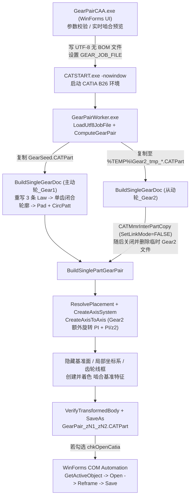

# 工程交接文档 — CATIA V5-6R2016 (B26) 直齿轮对生成器

> 本文档面向后续接手开发、维护或迁移的工程师，系统梳理 **CATIA V5-6R2016 (B26) 直齿轮对生成器 (`CAA_GearPair/`)** 的运行机制、协议约定、源码索引、环境迁移点、关键技术决策、已知局限与推荐后续演进方向。

---

## 1. 当前交付状态与已验证基线

- **项目状态**：核心功能已完成且经过清理后冒烟实测通过（`EXIT=0`，日志结尾输出 `=== GearPairWorker finished: SUCCESS ===`）。
- **清理后实测基线参数**：默认参数 `m=1.000, z1=34, z2=60, alpha=20.00 deg, x1=0.000, x2=0.000, b1=b2=6.000, R=0.100, axis=Y`
  - 工作中心距：`aw = 47.000000 mm`（`rw1 = 17.0000 mm`，`rw2 = 30.0000 mm`），重合度 `eps = 1.733`
  - `Gear1 (SINGLE_PART_GEAR1)`：`Vol = 5387.41 mm^3`，`BBox X[-18.150, 18.150] Y[-0.101, 6.101] Z[-18.050, 18.050]`
  - `Gear2 (SINGLE_PART_GEAR2)`：`Vol = 16878.65 mm^3`，`BBox X[14.268, 79.732] Y[-0.101, 6.101] Z[-32.732, 32.732]`
  - 参考特征包围盒验证通过：
    - `PitchC1`: `X[-17.001, 17.001] Y[-0.001, 0.001] Z[-17.001, 17.001]`
    - `PitchC2`: `X[16.999, 77.001] Y[-0.001, 0.001] Z[-30.001, 30.001]`
    - `CenterLine`: `X[-0.000, 47.000] Y[-0.000, 0.000] Z[-0.000, 0.000]`
    - `Shaft1` / `Shaft2`: `Y[-3.000, 9.000]`，分别位于 `X=0.000` 与 `X=47.000`

---

## 2. 端到端系统架构与数据流

---

## 3. `GEAR_JOB_FILE` 进程间通信协议

前端 `GearPairCAA_UI.vb` 将作业参数以 **UTF-8 无 BOM** 格式写入 `%TEMP%\caa_gear_job_<GUID>.txt`，并通过环境变量 `GEAR_JOB_FILE` 传递给 `CATSTART.exe -run GearPairWorker.exe`（避免命令行参数中文乱码与引号转义问题）。运行结束后由前端在 `Finally` 块删除该临时文件。

`GearPairWorker.cpp` 中 `LoadUtf8JobFile` 支持的全部键值如下：

| 键名 | 类型 / 取值 | 默认值（缺省时） | 说明 |
| --- | --- | --- | --- |
| `seed` | 绝对路径 (UTF-8) | `c:\齿轮生成\CAA_GearPair\win_b64\code\bin\GearSeed.CATPart` | 含原生 `GSMCurveEquations` 的种子模板路径 |
| `outDir` | 目录路径 (UTF-8) | `c:\齿轮生成\Output_CAA` | 输出目录；Worker 内部 `EnsureDirTreeW` 会自动逐级创建 |
| `m` | 正实数 (`mm`) | `1.0` | 模数 |
| `z1`, `z2` | 整数 (`>= 8`) | `34`, `60` | 主动轮 / 从动轮齿数 |
| `b1`, `b2` | 正实数 (`mm`) | `6.0`, `6.0` | 主动轮 / 从动轮齿宽 |
| `alpha` | 实数 (`0 < α < 45`, `°`) | `20.0` | 法向压力角 |
| `x1`, `x2` | 实数 | `0.0`, `0.0` | 主动轮 / 从动轮径向变位系数 |
| `backlash` | 实数 (`mm`) | `0.0` | 总齿侧间隙 $j_n$（单轮分摊 `backlash * 0.5`） |
| `filletR` | 非负实数 (`mm`) | `0.1` | 齿顶/齿根倒圆半径；`<= 1e-4` 时跳过倒圆保持尖角 |
| `axis` | `Y` / `Z` / `X` | `Y` | 齿轮轴向方向 `w` |
| `cx1`, `cy1`, `cz1` | 实数 (`mm`) | `0.0, 0.0, 0.0` | 主动轮中心坐标 `P1` |
| `useP2` | `0` 或 `1` | `0` | 是否启用指定的从动轮中心 `P2` |
| `cx2`, `cy2`, `cz2` | 实数 (`mm`) | `0.0, 0.0, 0.0` | 从动轮中心参考坐标 `P2` |

> 注：`GearPairWorker.exe` 同时保留命令行位置参数 fallback（`argc >= 10`）以及 `--verify-z <partPath> <z...>` 参数化重开更新验证模式。

---

## 4. 核心源码与配置索引

### 4.1 CAA C++ 内核：[GearPairWorker.cpp](CAA_GearPair/GearPairGen.edu/GearPairWorker.m/src/GearPairWorker.cpp)（1,641 行）

| 符号 / 区域 | 行号范围 | 核心职责 |
| --- | --- | --- |
| `GearSpec` / `GearPairParams` / `AssemblyPlacement` | `L112–L163` | 单轮、齿轮副啮合计算结果与装配定位数据结构 |
| `InvFunc` / `SolveInvAngle` | `L165–L182` | 渐开线函数 $\text{inv}(\alpha)=\tan\alpha-\alpha$ 及牛顿迭代反求啮合角 $\alpha_w$ |
| `MakeGearSpec` / `ComputeGearPair` | `L184–L246` | 计算标准/工作中心距 $a_w$、齿顶高变动系数 $\Delta y$、重合度 $\varepsilon$、齿厚 $s$ 与渐开线终止角 |
| `BytesToWide` / `WideToCat` / `WideToUtf8` / `CatToUtf8` | `L248–L284` | Windows UTF-8 / UTF-16 与 `CATUnicodeString` 编码转换 |
| `TryUpdateQuiet` / `SafeUpdate` | `L286–L320` | 基于 `CATTry`/`CATCatch(CATMfErrUpdate/CATError)` 的特征更新与诊断打印 |
| `FindShapeByAlias` / `GetPointRadiusXY` / `GetWireExtremityRadiiXY` | `L322–L372` | 按别名查找特征、读取点或线框端点的 XY 半径与坐标 |
| `FindCornerByRadii` | `L374–L447` | 遍历 `CreateTangentCircle` 的 32 种方向/判别索引组合，过滤互补大圆弧与反转角 |
| `AddFormula2/3/4` | `L449–L475` | 使用位置参数 `a1..a4` + `CATCke::False` 创建跨语言/字符安全的公式 |
| `BuildSingleGearDoc` | `L479–L974` | 复制种子零件 -> 创建中文参数与公式 -> 重写 3 条 Law -> 构建单齿封闭轮廓与填充面 -> 齿根圆柱与单齿 `CATIPad` -> `CATICircPatt` -> CGM 实体验证 |
| `VerifyMainBodySolid` | `L976–L1022` | 通过 `CATICGMDynMassProperties3D` 与包围盒检验体积 `> 0` 与对称/直径/齿宽范围 |
| `VerifyParametricZEdit` | `L1024–L1071` | 重开生成后的 `.CATPart`，修改参数 `齿数z` 后重新 Update 并校验实体（供 `--verify-z` 使用） |
| `ResolvePlacement` | `L1073–L1130` | 根据 `axis` 与 `P1/P2` 计算右手正交基 `(u, v, w)`，并按 `<= 0.01 mm` 容差决定直接采用 `P2` 或沿 `P1→P2` 投影定距 `aw` |
| `CreateMeshedProduct` | `L1132–L1243` | 可复用的双 `.CATPart` -> `.CATProduct` 装配与 `CATIMovable` 定位函数（**当前主流程 `main` 未调用，保留供后续扩展装配模式**） |
| `EnsureDirTreeW` / `LoadUtf8JobFile` | `L1245–L1302` | 递归创建输出目录；解析 UTF-8 无 BOM 任务文件 |
| `VerifyTransformedBody` | `L1304–L1324` | 校验定位后齿轮实体的 CGM 体积与包围盒 |
| `BuildSinglePartGearPair` | `L1326–L1571` | 单零件双实体核心流程：`CATMmrInterPartCopy` 无链拷贝 Gear2 -> `CreateAxisToAxis` 定位 -> 隐藏辅助要素 -> 创建并着色 `啮合基准特征` -> `SaveAs` |
| `main` | `L1573–L1641` | 批处理入口、支持 `--verify-z` 分支、读取 `GEAR_JOB_FILE` 或位置参数、创建/销毁 `CATSession` |

### 4.2 WinForms 前端：[GearPairCAA_UI.vb](CAA_GearPair/GearPairCAA_UI.vb)（419 行）

| 符号 / 区域 | 行号 | 核心职责 |
| --- | --- | --- |
| `MainForm.New` | `L22–L142` | 控件布局：标准模数下拉 `cmbModule`、`非标模数` 勾选框 `chkCustomModule`、轴向 `cmbAxis`、中心定位组 `grpPos`、`chkOpenCatia`、实时预览与日志区 |
| `Inv` / `SolveInv` | `L167–L182` | 界面实时预览用的渐开线与牛顿反解函数 |
| `CleanNumStr` / `ParseDouble` / `GetModuleText` | `L184–L201` | 清理末尾 `mm` / `deg` / `°` 后缀并按 `InvariantCulture` 解析数值 |
| `UpdatePreview` | `L203–L274` | 实时计算啮合参数、预测 `P2` 定位策略并更新 `txtPreview` |
| `CloseIfOpenInCatia` / `TryOpenAndCenterInCatia` | `L276–L324` | 通过 `Marshal.GetActiveObject("CATIA.Application")` 关闭同名旧文档、重开新 `.CATPart`、`ActiveViewer.Reframe()` 并 `Save()` |
| `OnGenerate` | `L326–L411` | 定位 `GearPairWorker.exe` / `GearSeed.CATPart` / `CATSTART.exe`，写 `GEAR_JOB_FILE` 并异步执行，刷新状态栏与日志 |

### 4.3 工程配置与构建脚本

- [IdentityCard.xml](CAA_GearPair/GearPairGen.edu/IdentityCard/IdentityCard.xml)：声明 16 个 CAA Prerequisite Frameworks（`SpecialAPI`、`System`、`ObjectModelerBase`、`ObjectSpecsModeler`、`MecModInterfaces`、`MechanicalModeler`、`PartInterfaces`、`GSMInterfaces`、`KnowledgeInterfaces`、`Mathematics`、`ProductStructure`、`Visualization`、`GeometricObjects`、`GMModelInterfaces`、`GMOperatorsInterfaces`）。
- [Imakefile.mk](CAA_GearPair/GearPairGen.edu/GearPairWorker.m/Imakefile.mk)：`BUILT_OBJECT_TYPE=LOAD MODULE` 与 `LINK_WITH` 链接库清单。
- [CATIAV5Level.lvl](CAA_GearPair/CATIAV5Level.lvl)：定义 `CATIAV5R1` 至 `CATIAV5R26`。
- [build_caa_gear.bat](CAA_GearPair/build_caa_gear.bat)：自动配置 VS2012 x64、TCK (`V5_6R2016_B26`)、`mkGetPreq`、`mkmk -a -u -w`、`mkCreateRuntimeView`，并同步本机运行依赖。
- [run_gear_caa.bat](CAA_GearPair/run_gear_caa.bat)：无界面冒烟运行脚本（默认参数或接受 9 个命令行位置参数）。

---

## 5. 环境迁移清单（换机部署 / 二开必看）

在更换开发机或目录后，请核对以下硬编码路径与 CATIA 环境配置：

| 文件位置 | 当前硬编码值 | 迁移说明 |
| --- | --- | --- |
| [GearPairCAA_UI.vb](CAA_GearPair/GearPairCAA_UI.vb#L78) | `txtOutDir = "c:\齿轮生成\Output_CAA"` | 默认输出目录，可在界面手动改或改源码默认值为相对程序目录 |
| [GearPairCAA_UI.vb](CAA_GearPair/GearPairCAA_UI.vb#L331), `L378` | `C:\Program Files\Dassault Systemes\B26\win_b64\code\bin\CATSTART.exe` `-env "CATIA_P3.V5-6R2016.B26" -direnv "C:\ProgramData\DassaultSystemes\CATEnv"` | 若目标机器 CATIA B26 安装路径或 Env 名称不同，须同步修改此处 |
| [run_gear_caa.bat](CAA_GearPair/run_gear_caa.bat#L7-L9) | 同上 `CATSTART` / `CATENV` / `CATDIRENV` | 批处理冒烟测试同上 |
| [build_caa_gear.bat](CAA_GearPair/build_caa_gear.bat#L7-L16) | VS2012 `vcvarsall.bat amd64`、B26 安装目录、`V5_6R2016_B26` | 仅重新编译 C++ 时依赖；需安装对应 RADE/TCK 与 VS2012 |
| [GearPairWorker.cpp](CAA_GearPair/GearPairGen.edu/GearPairWorker.m/src/GearPairWorker.cpp#L1590-L1591) | fallback `seedPath` 与 `outDir` | 由 `GEAR_JOB_FILE` 覆盖，仅直接不带参启动 `GearPairWorker.exe` 时生效 |
| 本地运行时视图 `CAA_GearPair/win_b64/` | `code/dictionary/`、`code/productIC/`、`control/` 及本机运行时环境文件 | Git 保留了目录结构与控制字典；本机运行时所需的 `.dll` 已被 `.gitignore` 排除，如换机运行且未执行 `build_caa_gear.bat`，需从目标机器 CATIA B26 环境补齐或重跑一次 `build_caa_gear.bat` |

---

## 6. 关键技术决策与排坑备忘

1. **为什么必须保留 `GearSeed.CATPart`？**
   - CATIA V5 的 `GSMCurveEquations` 与其底层关联的 3 条 `CATICkeLaw`（`LogSpiral_X_StandardEquation`、`LogSpiral_Y_StandardEquation`、`LogSpiral_Z_StandardEquation`）通过 CAA 公开工厂从零构造十分复杂；本方案复用种子模板内的原生特征与形式参数，再用 `CATICkeRelationExp::Modify` 动态重写表达式，可保证输出零件内为原生解析方程曲线且支持在 CATIA 中打开编辑参数 `齿数z` 后刷新重建。
2. **CATIA CKE 参数单位陷阱**
   - `CATICkeParmFactory::CreateLength` 内部接收 **米 (m)**（代码里统一 `mm / 1000.0`），`CreateAngle` 接收 **弧度 (rad)**；而 `CATIPad::ModifyEndOffset`、CGM 包围盒与几何输入则使用 **毫米 (mm)**。混用会导致尺寸差 1000 倍。
3. **公式与 Law 写入的语言无关性 (`CATCke::False`)**
   - `AddFormula2/3/4` 与 `spExp->Modify` 均使用位置形参 `a1, a2, ...` 并传入 `CATCke::False`，避免中文参数名在表达式解析或不同 CATIA 界面语言环境下出现引号/反引号语法错误。
4. **倒圆方向消歧 (`FindCornerByRadii`)**
   - CATIA `CreateTangentCircle` 存在 2 组线方向 × 2 组相切方向 × 2 个 `DiscriminationIndex` 共 32 种解，容易误选互补大圆弧或向内反转圆角。`FindCornerByRadii` 通过 `y0 > 0 && y1 > 0`、`chord <= 2.15 * filletR`、`boxDiag <= 2.15 * filletR` 以及与参考极角 `refTheta` 的单调性约束稳定锁定唯一短圆弧。
5. **无害字典 stderr 提示**
   - `CATSTART.exe` 启动时常在 stderr 打印 `MecModLiveInterfaces.iid line 1 ... CATIBRepModeCont` 重定义告警，属于 B26 安装环境固有字典行为，不影响建模与退出码。
6. **重新编译 `GearPairCAA.exe` 文件占用 (`BC31019`)**
   - 编译前端 EXE 前须先关闭正在运行的 `GearPairCAA.exe` 窗口。
7. **双实体历史特性差异**
   - 输出单 `.CATPart` 中，`主动轮_Gear1` 保留完整参数、方程与阵列历史；`从动轮_Gear2` 是通过 `CATMmrInterPartCopy`（`SetLinkMode(FALSE)`）复制的无外链独立实体结果，因此直接改写文件内主动轮参数时，从动轮不会自动联动，重新改参数需重新生成齿轮副。

---

## 7. 已知局限与后续可继续演进的方向

- **环境路径解耦**：将 `CATSTART.exe`、`CATEnv` 自动探测或支持配置文件/环境变量覆盖，消除机器路径硬编码；将 `GearPairCAA_UI.vb` 默认输出路径改为相对程序目录的 `Output_CAA`。
- **`CATProduct` 装配模式开关**：`GearPairWorker.cpp` 已实现但未启用的 `CreateMeshedProduct`（`L1132`）可直接扩展为生成双 `.CATPart` + `.CATProduct` 装配体的可选项，使从动轮也保留独立参数历史。
- **齿廓工艺与边界保护**：
  - 当前齿根为简化半径/直线 + 等半径相切倒圆，非滚刀展成渐开线过渡摆线（Trochoid）。
  - 可在前端与内核增加根切检查（少齿数/负变位警告）、齿顶变尖检查以及 `filletR` 上限校验（防止大倒圆在窄齿顶/齿槽上导致 `FindCornerByRadii` 无解）。
- **几何扩展**：支持斜齿轮（螺旋角 $\beta$ + 螺旋扫描）、内齿轮、中心轴孔与键槽特征。
- **自动化回归测试**：基于 `run_gear_caa.bat` 与 `--verify-z` 编写多组边界参数（奇/偶齿、正/负变位、非 Y 轴向、`filletR=0`、指定 `P2`）批量回归脚本。
